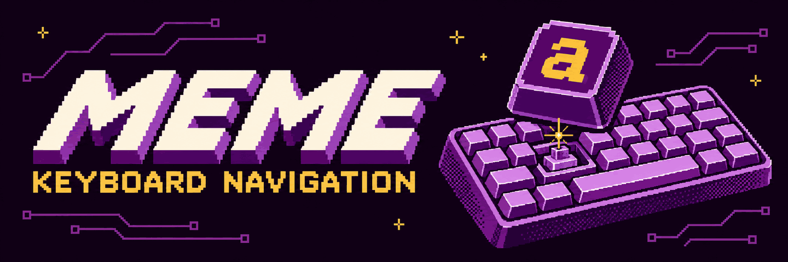
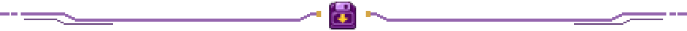
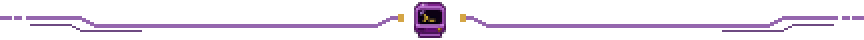

<picture></picture>

# Meme Keyboard Navigation

Browse Firefox from the keyboard. Press `a` on a web page, then type the label beside a visible link or button to click it. The pixel-art `a` in the toolbar opens the controls for the current tab and the shortcut editor.

<picture></picture>

## Install

Download the XPI from the [latest GitHub release](https://github.com/JustKato/meme-extension/releases/latest). Desktop Firefox 140 or later is supported.

- For a file ending in `-unsigned.xpi`, open `about:debugging#/runtime/this-firefox`, choose **Load Temporary Add-on**, and select the XPI. It stays active until Firefox restarts.
- For a Mozilla-signed XPI, open `about:addons`, choose the gear menu, then **Install Add-on From File**.

Click the purple **a** keycap at the top right. If it is hidden, open Firefox's **Extensions** menu, choose the gear beside **Meme Keyboard Navigation**, and select **Pin to Toolbar**. [Firefox toolbar help](https://support.mozilla.org/en-US/kb/extensions-button)

<picture></picture>

## Controls

| Default key | Action |
| --- | --- |
| `q` | Toggle navigation for the current tab. |
| `j` / `k` | Scroll down / up one line. Hold to repeat. |
| `f` / `b` | Scroll down / up one page. |
| `g` / `G` | Jump to the top / bottom of the scrolling area. |
| `t` / `x` | Open a new tab / close the current tab. |
| `h` / `l` | Switch one tab left / right. |
| `Ctrl+h` / `Ctrl+l` | Go back / forward in the current tab's history with focus on the web page. |
| `a` | Show labels on visible links and controls. |
| `Esc` / `Backspace` | Leave hint mode / erase the last letter of a hint. |
| `Enter` | Select an exact hint when longer labels share its prefix. |

On a page with 27 controls, the first control is labeled `a` and the last is `aa`. After opening hints, type `a` then Enter for the first, or `aa` for the last. An unambiguous label activates as soon as you finish typing it.

Open the toolbar popup and choose **Customize** under **Shortcuts**. Click a keycap and press a new shortcut, or use the switch beside that action to disable it. Your shortcut settings apply across tabs. The main navigation switch affects only the current tab. The address bar, protected pages and text editors keep their usual shortcuts. [Keyboard settings and Firefox compatibility](docs/keyboard.md)

<picture></picture>

## Development

Use Node.js 24.22.1 or later in the 24.x line, Firefox and geckodriver on your PATH.

```sh
npm ci
npm test
```

The test command lints the extension, builds an XPI into `dist/` and runs Firefox against the packaged add-on. To try a working copy interactively, load `extension/manifest.json` as a temporary add-on.

- [Local testing, GitHub Actions and release signing](docs/development.md)
- [Pixel-art keycap logos](docs/logos/README.md)
