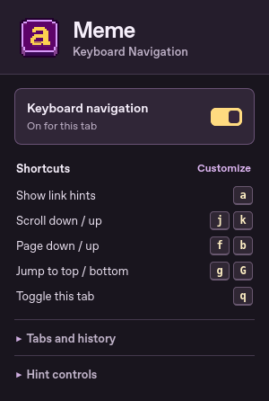
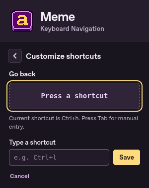

# Using the keyboard

## Toolbar and shortcut settings

Click the pixel-art **a** in the top-right toolbar to see the current tab's navigation switch and shortcut controls. If the icon is hidden, open the Firefox **Extensions** menu, choose the gear beside **Meme Keyboard Navigation**, then **Pin to Toolbar**.

New tabs start with navigation enabled. The switch and the `q` shortcut control the same tab setting, which follows the tab through reloads and navigation. Closing the tab or restarting Firefox clears that tab's setting.

Under **Shortcuts**, choose **Customize** to edit any action.

1. Select the action's keycap and press the new shortcut to save it immediately.
2. To enter a combination that Firefox intercepts during recording, use **Type a shortcut**, enter a value such as `Ctrl+l`, and choose **Save**. **Cancel** leaves the binding unchanged.
3. Use the switch beside an action to enable or disable it. **Restore defaults**, followed by **Restore**, restores all default bindings and enables the actions again.

| Toolbar menu | Changing the history shortcut |
| --- | --- |
|  |  |

The shortcut editor applies your key choices and each action's enabled state across all tabs. Changes are stored in your Firefox profile and survive browser restarts. You can use the popup switch even if you disable or forget the tab-toggle shortcut.

Each enabled action needs a unique key within its mode. To reuse a key on the page, rebind or disable the action currently using it. A page action and a hint-mode action can share a key. Bare letters are case-sensitive (`g` and `G` are different), and adding Shift to a modified letter creates a different chord (`Ctrl+h` and `Ctrl+Shift+h`).

## Tabs and history

Press `t` to open an active new tab or `x` to close the current tab. Use `h` and `l` to move left and right through the visible tabs of the current window. At either end, movement wraps to the other end. New tabs use Firefox's usual new-tab page. Once the address bar has focus, type a URL or search as usual.

Back and forward follow the current tab's browsing history. With focus on an ordinary web page, `Ctrl+h` goes back and `Ctrl+l` goes forward. The address bar, browser UI and excluded editing contexts retain their native behavior. If your desktop or browser configuration intercepts a particular chord, choose another binding in **Customize**. [Firefox keyboard shortcuts](https://support.mozilla.org/en-US/kb/keyboard-shortcuts-perform-firefox-tasks-quickly)

## Focus and scrolling

On a normal page, `j` and `k` use Firefox's line scroll and `f` and `b` use its page scroll. With focus inside a vertically scrollable panel, the same keys operate on that panel. `g` and `G` jump to its edges. On an app layout with a fixed outer page, the extension also checks for a scrollable panel at the center of the viewport.

Text inputs, textareas, editable HTML, select menus and common ARIA input widgets keep their typing and IME behavior. Use Tab or Shift+Tab to move focus out of an editor and resume navigation. Only configured, enabled shortcuts are handled. Holding a scroll key repeats the movement. Tab, toggle and hint actions run once per press.

## Choosing a target

The following examples use the default bindings. Press `a` to show the letters. Type the label exactly as displayed. The overlay filters as you type and indicates when Enter can choose a shorter label. A prefix stays active until you finish typing or cancel. Backspace corrects a prefix. Esc closes the overlay. Tab closes it and continues normal focus traversal. While hints are visible, letters such as `q`, `t` and `x` select labels.

You can change or disable the hint controls in the popup. Lowercase `a` through `z` are reserved for typing labels. Tab and Shift+Tab always leave hints and move focus. Keep a confirmation key enabled if you want to select short labels that also begin longer labels.

The first scan assigns labels in document order, including open shadow roots, slotted content and visible controls inside same-origin frames. Offscreen, clipped, hidden, disabled, inert and covered controls are checked before labels are shown. When scrolling or a site update changes the candidates, surviving elements keep their labels and newly visible ones receive the next letters. Reopening hints starts the alphabet again in current page order. Selection checks the element's visibility again before clicking it.

Targets include links with destinations, native buttons and form controls, expandable summaries, editable hosts, recognized ARIA controls, inline click handlers and focusable custom elements. A separate-origin frame gets an entry label. Select it to give the frame focus, then press `a` again to label its controls. Tab and Shift+Tab can move focus between the frame and its surroundings.

Hint selection delivers a primary pointer and mouse press, focuses the control when appropriate, releases the pointer and sends a click at its visible position. Normal link navigation, new-tab targets, form submissions, checkboxes and page click handlers use their usual DOM behavior. Selecting a text field puts the caret there for typing.

## Firefox compatibility

- The address bar, the built-in new-tab page, settings pages such as `about:addons`, the PDF viewer and restricted Mozilla domains use Firefox's own keyboard controls. The extension runs on permitted HTTP, HTTPS and local file pages. [Mozilla's content script restrictions](https://developer.mozilla.org/en-US/docs/Mozilla/Add-ons/WebExtensions/Content_scripts#restricted_domains)
- A site can require a trusted physical pointer event. Firefox marks script-dispatched pointer and mouse events as untrusted, including those sent while handling a real keypress. Canvas-only controls and closed shadow trees may expose only their host as a target. [DOM event trust](https://developer.mozilla.org/en-US/docs/Web/API/Event/isTrusted)
- Firefox can withhold site access. In the extensions menu, grant the extension access to the site. In private windows, Firefox also requires the **Run in Private Windows** setting for the extension.
- Page and frame access lets the extension find controls locally. Session storage holds the disabled flag for each tab. Local extension storage holds your shortcut settings. The extension makes no network requests and sends no page content, URLs or keystrokes to a service.
